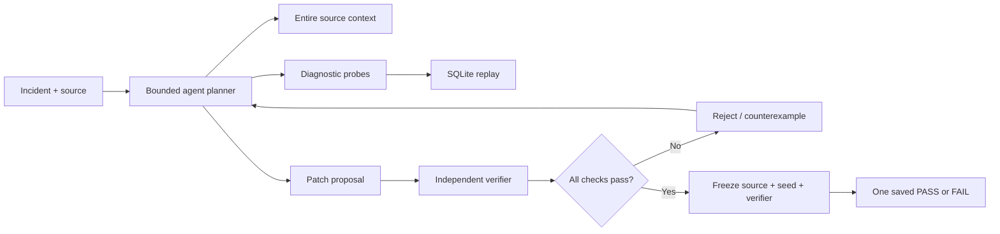

# NeatRescue — Don't ship a fix that breaks someone else

**neatHack 2026 · team SFAB (solo entry) · [Watch the 90-second demo](https://neatrescue-demo-2026.onrender.com/media/NeatRescue_VOICE_CUT_90s.mp4) · [Interactive preview](https://neatrescue-demo-2026.onrender.com/) · [Dated build log](hackathon.md)**

An AI-agent repair proposal can make one failing example green while quietly rejecting legitimate customer operations. **NeatRescue investigates the failure, challenges plausible partial repairs, and prevents an unverified patch from being accepted.**

> The strongest claim is not that our model writes better code. It is that the **acceptance decision is independently checked, version-bound, auditable and recoverable**.


## The demonstrable incident

In a **synthetic** refund system, payment commits before its acknowledgement is lost. The workflow retries with a different attempt identifier. Three legitimate logical refunds should produce exactly three payment rows.

| Candidate source | Persisted payments | Why it matters |
|---|---:|---|
| Faulty attempt-scoped operation key | **4** | The same refund is paid again |
| Plausible order-only quick fix | **1** | It stops the duplicate but suppresses two other legitimate refunds |
| NeatRescue's accepted patch | **3** | Correct logical refund identity; sibling and cross-tenant requests still work |
| Direct one-shot LLM repair | **3** | Also correct — **no superior code-generation claim** |

These results come from a **real SQLite commit → lost acknowledgement → connection close/reopen → retry** demonstration. The simulated ledger never touches real customer money.

The agent used **eight model-selected tool decisions**, inspected source context through **Entire**, proposed **one patch**, and passed **128/128 generated adapter cases plus the ledger invariants**. A separate gate validates the source and records one durable final verdict per origin.

## Architecture



The output is a **candidate requiring human approval**, never an automatic production deployment.

## How to reproduce

Requirements: Python 3.11+, local Ollama or an authenticated Claude Code CLI, and the open-source [Entire CLI](https://github.com/entireio/cli) and [entire-graph](https://github.com/entireio/entire-graph) binaries for context retrieval.

```bash
python3 -m venv .venv
.venv/bin/python -m pip install -r requirements.txt
.venv/bin/python -m unittest discover -s tests -v

# Pure verification; no model calls or paid services:
.venv/bin/python - <<'PY'
from neatrescue.ledger_replay import replay
from pathlib import Path
for name in ('faulty_adapter','proposed_order_only_fix','accepted_source','direct_source'):
    source = Path('evidence', name + '.py').read_text()
    result = replay(source, seed=117)
    print(name, len(result['observed']['payment_rows']), result['passed'])
PY

# A NEW investigation; uses your model/service and Entire:
.venv/bin/python -m neatrescue.blind_agent --source-file evidence/faulty_adapter.py --incoming-file evidence/proposed_order_only_fix.py
```

The real agent run requires Entire's `entire-graph` executable at `.tools/entire-graph` and a configured model provider. It does not execute arbitrary Python; candidate source is evaluated in a restricted AST subset. Models may not reproduce a saved decision deterministically. The recorded evidence is kept separate from newly run experiments.

## Judge-checkable evidence

- `evidence/PUBLIC_RESULTS.json` — aggregate reported results and final-plan fingerprints.
- `evidence/{faulty,incomplete_order_only,accepted,direct}_sqlite_replay.json` — synthetic replay event logs and observed rows.
- `evidence/{faulty_adapter,proposed_order_only_fix,accepted_source,direct_source}.py` — compared actual source.
- `evidence/ENTIRE_CHECKPOINT.json` — recorded Entire checkpoint provenance.
- `docs/DURABLE_GATE_LEDGER_RESULTS_20261010.md` — design, recovery constraints, failure caveats.
- `media/NeatRescue_VOICE_CUT_90s.mp4` — **90-second English-narrated recorded evidence visualization**, not a filmed live run; voice generated with Kokoro. The silent 140-second backup is retained in the media folder.

## Sponsor integration status — evidence, not logos

| Required tool | Implemented role | Submission evidence |
|---|---|---|
| **neatlogs** | Python SDK agent/workflow/tool tracing | SDK wiring and **local Doctor v2 passed again on Oct 12**; see evidence/NEATLOGS_LOCAL_DOCTOR_20261012.json. **Authenticated cloud traces are not yet confirmed** |
| **Entire** | Coding checkpoints and actual source-graph context | Recorded checkpoint and graph output; context consumed in agent run |
| **cfo.ai** | Pricing, costs, revenue and runway planning | Account activation reported Oct 12; [model prompt and export workflow](docs/cfo_ai/QUICK_START.md) prepared. **Actual saved model/report still pending and not claimed as sponsor proof** |

The hackathon explicitly requires all three. We won't pretend the submission is fully compliant without cloud traces and a real cfo.ai plan.

## Reproducibility and boundaries

All original project code was written during the Oct 10–12, 2026 build window. This is a **curated public-export snapshot**, separate from the original private development repository. Its snapshot commit is not presented as a comprehensive original development history. The original event-period development records remain available for verification by the owner.

The prototype covers four pure Python adapter functions and a small synthetic business contract. **It cannot prove generalized software repair ability, causal safety, production-grade exactly-once payments, or LLM reasoning superiority.** A single direct model prompt fixed this example too. It demonstrates bounded **verification and refusal**, including recovery of the same final verdict following an interrupted pure check. Local hashes protect consistency of artifacts; they are not third-party cryptographic attestation.

The cinematic hero image is **Adobe Firefly-generated illustration**, not footage of an actual customer.

**Submission state (Oct 12):** Public GitHub repository and Render demo are live and externally accessible. Entire evidence and Neatlogs local SDK test are documented. Authenticated Neatlogs cloud traces, a genuine cfo.ai-generated business plan, participant check-in and the official X quote post are still unverified. **This has not yet been formally submitted.** Official rules: https://neatlogs.com/hackathon.
